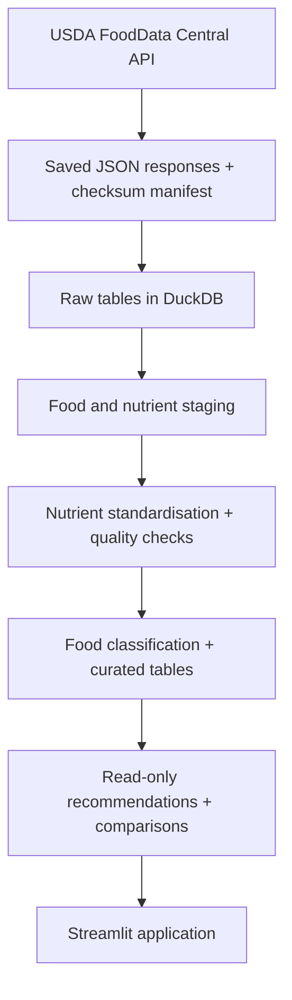

# MacroMatch - The Data School Application

**Explore, compare, and discover foods that match your nutritional goals.**

MacroMatch is a Python, DuckDB and Streamlit project for The Data School's Data Engineering Consultant application. It is built using a pipeline of food composition data from the US Department of Agriculture (USDA), and combines a frontend application with the data engineering needed to make results traceable and understandable.

## What I built and who for

I built MacroMatch for people who want to make more informed dietary choices by exploring the nutritional composition of foods, allowing them to make informed comparisons. For example, someone trying to increase their protein or fibre intake can look for foods that fit those preferences rather than manually comparing nutritional values. It is also useful for anyone who wants to compare portions of several ingredients all at once.

It has three main features:

- **Discover foods:** Search and filter all foods, inspect their nutritional values, and check where their data came from.
- **Get recommendations:** Select one or more nutritional goals, adjust their importance, and see ranked results with explanations. Foods with insufficient data are shown separately instead of being given misleading scores.
- **Compare foods:** Compare 2-4 foods using user defined portion sizes, with values scaled from source measurements. 

## The data

**Source:** [USDA FoodData Central](https://fdc.nal.usda.gov/)

**API documentation:** [FoodData Central API Guide](https://fdc.nal.usda.gov/api-guide/)

**Data licence:** [CC0 1.0 Universal](https://creativecommons.org/publicdomain/zero/1.0/)

I used two USDA datasets:

- **Foundation Foods**, which contains detailed food-composition records and information about their measurements.
- **SR Legacy**, a historical reference collection of nutrient values for commonly consumed foods.

### Exploratory API audit

An initial investigation sampled 156 USDA food records across Foundation Foods and SR Legacy.

The audit found:
- 96.8% completeness for core macros.
- 73.7% completeness when including fibre.
- Different energy calculation definitions.
- Missing nutritional measurements and anomalous values.
- Ambiguous search results and overlapping food descriptions.

These findings inform the data cleaning, modelling and validation requirements for MacroMatch.

Following the audit, I created a frozen dataset containing 166 food records, 69 from Foundation Foods and 97 from SR Legacy. The original API responses are preserved alongside a manifest containing extraction information and file checksums. This allows the data pipline to be reproduced without making additional API requests. The dataset contains 12,108 nutritional entries, which are staged, standardised, and validated before being used by the application. 

Nutritional measurements are not always available for every food. For example, only 101/166 foods have validated total sugars measurements. Rather than treating missing measurements as zero, I preserve their unavailable status so users are not presented with misleading nutritional information. 

[Read the full data audit](docs/data_audit.md)

[View the audit code and results](audits/usda/)

## How it works

Data collection, data preparation, data quality checking, and using the data in the application are all separated:



**1. Extract and preserve the raw data.** Retrieve the records from the USDA API, ensuring the saved JSON responses remain unchanged. Each response has a checksum so the pipeline can detect any unexpected changes to its input. The records are then loaded into DuckDB.

**2. Stage the food and nutrient records.** The API returns nested JSON with different structures and nutrient definitions. I turn these into consistent tables: one food record per source identity and a separate record for each nutrient entry. Original descriptions, source locations and identifiers are retained for traceability.

**3. Standardise nutrients and assess quality.** I map the nutrient definitions used by both datasets to a small set of comparable metrics. Energy needs particular focus as the API can supply more than one calculation method, so I apply explicit selection rules and preserve the method chosen. Quality checks are used to identify absent measurements, negative values, and other anomalies. A value that cannot be used is flagged as unavailable rather than being replaced or guessed.

**4. Classify and curate foods.** Food descriptions are classified into food groups and preparation types, with review flags for any ambiguous entries. Similar descriptions are not enough to prove two records are equivalent, so I keep their separate identities unless equivalence is explicitly approved. The curated tables retain all searchable foods, including those that are incomplete for certain user goals.

**5. Generate recommendations.** Users are able to select goals such as increasing protein or fibre, lowering fat or sugars, and increasing or decreasing calories. For a singular goal, the system ranks foods using the validated nutritional measurements. For multiple goals, it combines the individual component scores using user selected weighting. A separate balanced nutrition preset is also available. Scores are rule based, and foods missing a measurement needed for the selected goals appear in a separate unranked section, with the reason explained. 

**6. Compare portions.** The comparison section of the app reads the same curated data. It allows 2-4 foods to be compared fairly, while clearly distinguishing the difference between missing measurements and zero-value measurements. Nutritional measurements are scaled from their per 100g values using the formula: **Nutruient in selected portion = Nutrient per 100g × (Portion size / 100).**

**7. Testing the results.** Automated tests cover ingestion, transformation rules, quality checks, recommendations, comparisons, and UI behaviour. GitHub Actions also runs the tests and verifies that the database can be rebuilt from the raw data. Two independent rebuilds are compared to confirm that the resulting table contents match, while further checks verify that application queries do not modify the database. 

For a further explanation of all decisions, see
[ingestion](docs/ingestion.md), [nutrient standardisation](docs/nutrient_standardisation.md), [data quality](docs/data_quality.md), [food classification](docs/food_classification.md), [curated data](docs/curated_data.md), [recommendations](docs/recommendation_engine.md), [comparisons](docs/food_comparisons.md) and [CI/reproducibility](docs/ci_reproducibility.md). The [`docs/decisions`](docs/decisions/) directory records individual engineering decisions.


## How to run it

The project can be reproduced from the committed snapshot, and you do not need a USDA API key to rebuild the database or run the application.

**Requirements:** Git and Python 3.13

Use the commands below:
**1. Clone the repository, create an environment and install dependencies:**

```powershell
git clone https://github.com/matthewkaipoon/macromatch.git
cd macromatch
py -3.13 -m venv .venv
.\.venv\Scripts\python.exe -m pip install -r requirements.txt
```

**2. Rebuild the local DuckDB database from the saved raw data:**

```powershell
.\.venv\Scripts\python.exe .\scripts\ingest_usda.py --snapshot .\data\raw\m04_catalog_v1
.\.venv\Scripts\python.exe .\scripts\stage_foods.py
.\.venv\Scripts\python.exe .\scripts\stage_nutrients.py
.\.venv\Scripts\python.exe .\scripts\standardise_nutrients.py
.\.venv\Scripts\python.exe .\scripts\check_quality.py
.\.venv\Scripts\python.exe .\scripts\classify_foods.py
.\.venv\Scripts\python.exe .\scripts\build_curated.py
.\.venv\Scripts\python.exe .\scripts\build_total_sugars.py
```

This creates `data/processed/macromatch.duckdb` locally. The generated database is not committed to Git; the saved inputs and transformation code are the reproducible source of truth.

**3. Run the tests and optional full reproducibility check:**

```powershell
.\.venv\Scripts\python.exe -m pytest -q
.\.venv\Scripts\python.exe .\scripts\m16_verify.py --report .\data\temp\m16-local-report.json
```

The second command makes two independent temporary database builds and checks that their table contents match. It also checks read-only behaviour. It does not replace the application database built in step 2.

**4. Launch MacroMatch:**

```powershell
.\.venv\Scripts\python.exe -m streamlit run app/streamlit_app.py
```

The automated workflow is available in [GitHub Actions](https://github.com/matthewkaipoon/macromatch/actions).

## What I would do next

1. **Expand the food coverage.** There currently is 166 food entries, which is sufficient enough for demonstrating the pipeline, but limits the variety of recommendations, so I would develop a broader sampling strategy with new records. 

2. **Improve missing data coverage.** Currently, total sugars and fibre are absent for some foods. In future, I would investigate other sources or measurements to broaden data coverage. 

3. **Add meal planning.** The next feature of this application would let users combine several chosen foods into a meal, adjust portions and see total nutrients against their defined goals. 


## Where AI helped

During the beginning of my project, I used AI to help with researching relevant APIs based on my own project ideas. Having explored multiple ideas, AI helped me determine which of those ideas included a relevant API that would match the requirements of this project.

The overall direction, structure, and planning of the project were my own: I defined the project scope, its milestones, and how each stage should be implemented. I used AI to write the code that translated my ideas and technical requirements, including all automated tests. I was responsible for planning and defining the implementation, reviewing results, running tests, identifying implementation issues and determining what needed to be changed. This allowed me to focus on the reasoning and decision making around the project, while using AI for the development process.

**Data attribution:** Nutritional information sourced from USDA FoodData Central, U.S. Department of Agriculture, Agricultural Research Service. The USDA data is available under CC0 1.0 Universal.
